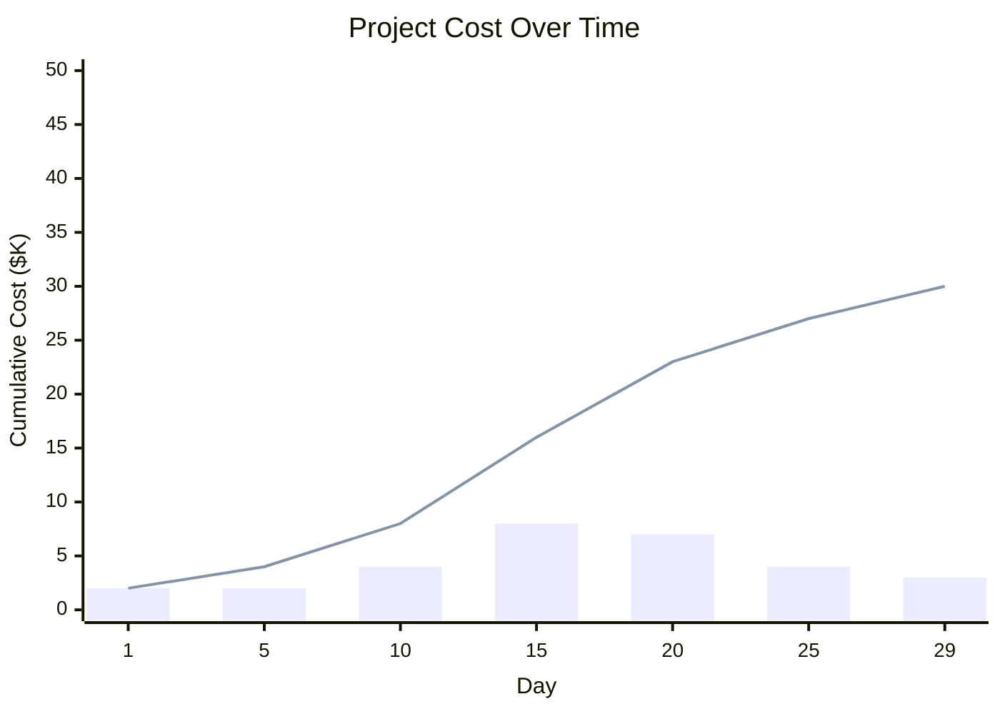

# Project Planning Skill

## Purpose

This skill walks you through **Juval Lowy's project planning methodology** step by step, starting from an input architecture and producing three concrete deliverables:

1. **Activity Diagram** — A JSON Canvas (`.canvas`) showing the project network with dependencies and the critical path highlighted.
2. **Project Cost Over Time** — A chart (ASCII table + Mermaid) showing the staffing-distribution curve and cumulative cost.
3. **Earned Value Over Time** — A chart (ASCII table + Mermaid) showing the shallow S curve with planned, actual progress, and actual effort.

> [!quote] Key Principle
> *"A project plan is not a Gantt chart: it's how you staff, size services, architect one person in command, and map team structure. Everything else is decoration."* — Juval Lowy

---

## Prerequisites

Before running this skill, ensure you have:

- **Input architecture**: A list of services (activities) with their dependencies (predecessors). This should come from the module notes in `Modules/Project Planning.md`, especially the sections on Critical Path and Composable Design.
- **Estimates**: Durations for each service (use nominal estimates: 5, 10, 15, 20 — not precise numbers).
- **Output directory**: A folder for generated artifacts (e.g., `99-Resources/Charts/Project-<name>/`).

---

## Workflow: The 7 Stages

Walk through these stages **in order**. At each stage, ask the user for input or confirm assumptions before proceeding.

---

### Stage 1: Gather the Architecture

**Ask the user:**

> What is the architecture of the system you're planning?
> 
> Provide the list of services (activities) and their dependencies. For example:
> ```
> Activities:
> - A: Requirements Review (5 days)
> - B: Test Plan (3 days) [depends on A]
> - C: Throwaway Construction (4 days) [depends on A]
> - D: Detail Design (6 days) [depends on B, C]
> - E: Construction (8 days) [depends on D]
> - F: Code Review (3 days) [depends on E]
> - G: Integration & Testing (5 days) [depends on F]
> ```

**Validate the input:**
- Every activity has a duration (nominal estimate: 5, 10, 15, 20, etc.)
- Dependencies form a DAG (no cycles)
- There is a single "start" node (no predecessors) and a single "end" node (no successors), or you can derive them

> [!tip] If estimates are missing
> Ask the user for rough estimates. Remind them: "Estimates don't matter nearly as much as getting the topology right. Use nominal numbers (5, 10, 15, 20) — not precise ones."

---

### Stage 2: Compute the Critical Path

**Compute forward pass** (earliest start / earliest finish):
- For the start node: ES = 0, EF = duration
- For each subsequent node: ES = max(EF of all predecessors), EF = ES + duration

**Compute backward pass** (latest start / latest finish):
- For the end node: LF = EF of end node, LS = LF - duration
- For each preceding node: LF = min(LS of all successors), LS = LF - duration

**Compute float:**
- Float = LS - ES (or LF - EF)

**Identify the critical path:**
- The critical path is the longest path through the network (highest total duration)
- All activities on the critical path have **float = 0**

**Present the results to the user:**

```
## Critical Path Analysis

| Activity | Duration | ES  | EF  | LS  | LF  | Float | Critical |
|----------|----------|-----|-----|-----|-----|-------|----------|
| A        | 5        | 0   | 5   | 0   | 5   | 0     | ✅       |
| B        | 3        | 5   | 8   | 5   | 8   | 0     | ✅       |
| ...      | ...      | ... | ... | ... | ... | ...   | ...      |

### Critical Path: A → B → D → E → F → G (total: 29 days)
### Total Project Duration: 29 days
```

> [!danger] Key Insight
> *"James Kelly published the critical path paper in 1959. For 60 years, nobody improved on it. This is the only way mankind has figured out to answer: how long will it take?"*

---

### Stage 3: Generate the Activity Diagram (JSON Canvas)

**Create a JSON Canvas file** at `99-Resources/Charts/Project-<name>/activity-diagram.canvas`.

**Use the `json-canvas` skill** to create the diagram. Structure it as follows:

**Nodes (activities):**
- Each activity is a `text` node
- Color-code by float:
  - Black/Orange: Float = 0 (critical path)
  - Red: Low float (1–3 days)
  - Yellow: Medium float (4–7 days)
  - Green: High float (>7 days)
- Position nodes left-to-right by earliest start time (ES)

**Edges (dependencies):**
- Each dependency is an `edge` with `fromNode` and `toNode`
- Highlight critical-path edges with arrow styling

**Example structure:**

```json
{
  "nodes": [
    {
      "id": "a-req-review",
      "type": "text",
      "x": 0,
      "y": 200,
      "width": 200,
      "height": 80,
      "text": "A: Requirements Review\nDuration: 5 days\nFloat: 0 (Critical)",
      "color": "2"
    },
    ...
  ],
  "edges": [
    {
      "id": "edge-a-b",
      "fromNode": "a-req-review",
      "toNode": "b-test-plan",
      "fromSide": "right",
      "toNode": "right",
      "toEnd": "arrow"
    },
    ...
  ]
}
```

**Present the canvas to the user:**

> The activity diagram has been generated at `99-Resources/Charts/Project-<name>/activity-diagram.canvas`. Open it in Obsidian Canvas to visualize the project network with the critical path highlighted in orange.

---

### Stage 4: Determine Dynamic Staffing

**Apply the float-based staffing rule:**
1. Assign the critical path first (float = 0)
2. Then assign the next-lowest-float activity
3. Continue up the float spectrum

**Determine staffing levels:**
- Day 1: Core team (architect, PM) — usually 1–3 people
- As critical-path activities begin, assign developers one-to-one per service (1:1 rule)
- Ramp up as enabling activities complete and more services become ready for construction
- Ramp down as construction finishes and only integration/testing remains

**Calculate the staffing curve:**
- For each day (or week), count how many developers are actively working on services
- Plot this as the staffing distribution curve

**Present the staffing plan:**

```
## Dynamic Staffing Plan

| Day | Staffing Level | Activities Active | Notes |
|-----|---------------|-------------------|-------|
| 1   | 2             | A, B              | Core team starts |
| 2   | 2             | A, B              | ... |
| ... | ...           | ...               | ... |
| 15  | 8             | C, D, E           | Peak staffing |
| ... | ...           | ...               | ... |
| 25  | 3             | G                 | Ramp down |

### Peak Staffing: 8 developers
### Project Duration: 29 days
```

> [!tip] Key Insight
> *"The only correct way to assign resources to a project is based on float, low to high. If you assign an activity with insufficient float before a lower-float activity, that lower-float activity becomes critical, the critical path shifts, and you derail the project."*

---

### Stage 5: Generate the Project Cost Over Time Chart

**Calculate cost:**
- Cost = Staffing × Time (area under the staffing curve)
- Use a daily rate (e.g., $1,000/day per developer)
- Cumulative cost at each day = sum of (staffing level × daily rate) for all days up to that point

**Create a Mermaid chart** showing the staffing distribution and cumulative cost.

**Example Mermaid (bar chart for staffing, line for cumulative cost):**



**Also create a table for reference:**

```
## Project Cost Summary

| Day | Staffing | Daily Cost | Cumulative Cost |
|-----|----------|------------|-----------------|
| 1   | 2        | $2,000     | $2,000          |
| 2   | 2        | $2,000     | $4,000          |
| ... | ...      | ...        | ...             |
| 29  | 3        | $3,000     | $30,000         |

### Total Project Cost: $30,000
### Average Staffing: 4.8 developers
```

> [!quote] Key Insight
> *"The cost of a software project is labor — staffing times time. The area under the staffing-distribution curve is the total cost. Once you draw the curve, you can calculate cost with simple addition in Excel. This is the only way to answer: how much will it cost?"*

---

### Stage 6: Generate the Earned Value Over Time Chart

**Define earned value metrics:**
- **Planned Value (PV)**: The planned cumulative cost at each point in time (the shallow S curve)
- **Earned Value (EV)**: The actual value of work completed at each point in time
- **Actual Cost (AC)**: The actual cost incurred at each point in time

**Calculate planned value:**
- PV at each day = sum of (staffing level × daily rate) for all days up to that point, assuming the plan is followed perfectly
- This creates the shallow S curve

**Calculate earned value:**
- For each activity, assign a weight (e.g., Requirements 20%, Design 30%, Construction 50%)
- An activity is "earned" only when its review/exit criteria are met (binary: done or not done)
- EV at each day = sum of (weight × duration × daily rate) for all completed activities

**Calculate actual cost:**
- AC = sum of (actual days worked × daily rate) for all days up to that point

**Create the earned value chart:**

```mermaid
xychart-beta
    title "Earned Value Analysis"
    x-axis "Day" [1, 5, 10, 15, 20, 25, 29]
    y-axis "Value ($K)" 0 --> 30
    line [2, 4, 8, 16, 23, 27, 30] label "Planned Value (PV)"
    line [2, 4, 7, 14, 20, 25, 28] label "Earned Value (EV)"
    line [2, 4, 9, 18, 25, 30, 32] label "Actual Cost (AC)"
```

**Also create a summary table:**

```
## Earned Value Summary (Day 15)

| Metric | Value |
|--------|-------|
| Planned Value (PV) | $16,000 |
| Earned Value (EV)  | $14,000 |
| Actual Cost (AC)   | $18,000 |
| Schedule Variance (SV = EV - PV) | -$2,000 (Behind schedule) |
| Cost Variance (CV = EV - AC) | -$4,000 (Over budget) |

### Diagnosis: Progress below plan, effort above plan → Underestimation
### Remedy: Push the schedule out OR reduce scope OR over-deliver (add scope)
```

> [!danger] Key Insight
> *"NEVER BASE PROGRESS REPORTS ON FEATURES. BASE IT ON SMALL INTEGRATION POINTS."*
> 
> *"If you don't project, you do not have a project. You know what you have? A bunch of lawless monkeys smearing code on monitors."*

---

### Stage 7: Present the Complete Project Plan

**Summarize all deliverables:**

```
## Project Plan Summary

### Project: <name>
### Total Duration: 29 days
### Total Cost: $30,000
### Peak Staffing: 8 developers

### Deliverables Generated:
1. ✅ **Activity Diagram** — `99-Resources/Charts/Project-<name>/activity-diagram.canvas`
2. ✅ **Cost Over Time Chart** — See table and Mermaid chart above
3. ✅ **Earned Value Over Time Chart** — See table and Mermaid chart above

### Critical Path: A → B → D → E → F → G (29 days)

### Risk Areas (Low Float):
- Activity C: Float = 2 days (monitor closely)
- Activity D: Float = 0 days (critical)

### Recommendations:
- Assign your best developer to the critical path
- Track progress based on integration points, not features
- Generate these charts every Friday and project forward
```

---

## Error Handling

| Error | Diagnosis | Remedy |
|-------|-----------|--------|
| Cycle in dependencies | Invalid DAG | Ask user to clarify dependency structure |
| Missing duration estimates | Incomplete input | Ask user for nominal estimates (5, 10, 15, 20) |
| No critical path found | All activities have float | Re-check backward pass calculations |
| Staffing exceeds user's team size | Overstaffed plan | Ask user to reduce scope or extend timeline |
| Cost exceeds budget | Over-budget plan | Present options: reduce scope, extend timeline, or add budget (with sign-off) |

---

## References

- **Module Notes**: `Modules/Project Planning.md` (especially Critical Path, Float, and Earned Value sections)
- **Service Lifecycle**: `Modules/Project Planning.md#Service Lifecycle — Testing, Construction & the Waterfall Truth`
- **Project Tracking**: `Modules/Project Planning.md#Project Tracking — Earned Value, Shallow S, and Living Plans`
- **Composable Design**: `Modules/Project Planning.md#Composable Design — Core Use Cases, Components & Agility`
- **Transcripts**: `99-Resources/Transcripts/` (Staffing, Planning, Service Lifecycle, Project Tracking, Project Design)

---

## Quick Reference: Juval's Key Formulas

| Concept | Formula/Rule |
|---------|--------------|
| **Service Sizing** | Area of minimal cost (not too big, not too many) |
| **Staffing** | 1:1 mapping (one developer per service, at any given time) |
| **Critical Path** | Longest path through the network (quickest possible completion) |
| **Float** | LS - ES (or LF - EF) — assign resources low to high float |
| **Cost** | Staffing × Time (area under the staffing curve) |
| **Integration Cost** | x! (x factorial) — integrate incrementally |
| **Earned Value** | EV = sum of (weight × duration × rate) for completed activities |
| **Schedule Variance** | SV = EV - PV (negative = behind schedule) |
| **Cost Variance** | CV = EV - AC (negative = over budget) |

---

## Example Walkthrough

See `references/EXAMPLE.md` for a complete worked example with a sample architecture, critical path computation, and all three generated charts.
