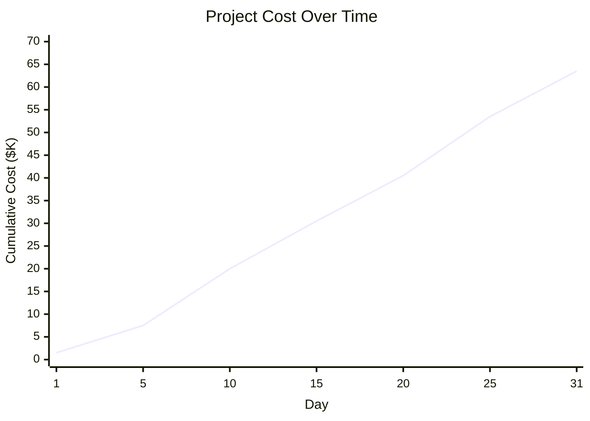

# Project Planning — Complete Example

## Input Architecture

```
Activities:
- A: Requirements Review (5 days)
- B: Test Plan (3 days) [depends on A]
- C: Throwaway Construction (4 days) [depends on A]
- D: Detail Design (6 days) [depends on B, C]
- E: Construction (8 days) [depends on D]
- F: Code Review (3 days) [depends on E]
- G: Integration & Testing (5 days) [depends on F]
```

---

## Stage 2: Critical Path Analysis

### Forward Pass

| Activity | Duration | Predecessors | ES  | EF  |
|----------|----------|--------------|-----|-----|
| A        | 5        | —            | 0   | 5   |
| B        | 3        | A            | 5   | 8   |
| C        | 4        | A            | 5   | 9   |
| D        | 6        | B, C         | 9   | 15  |
| E        | 8        | D            | 15  | 23  |
| F        | 3        | E            | 23  | 26  |
| G        | 5        | F            | 26  | 31  |

### Backward Pass

| Activity | Duration | Successors | LF  | LS  |
|----------|----------|------------|-----|-----|
| G        | 5        | —          | 31  | 26  |
| F        | 3        | G          | 26  | 23  |
| E        | 8        | F          | 23  | 15  |
| D        | 6        | E          | 15  | 9   |
| C        | 4        | D          | 9   | 5   |
| B        | 3        | D          | 9   | 6   |
| A        | 5        | B, C       | 5   | 0   |

### Float Calculation

| Activity | Duration | ES  | EF  | LS  | LF  | Float | Critical |
|----------|----------|-----|-----|-----|-----|-------|----------|
| A        | 5        | 0   | 5   | 0   | 5   | 0     | ✅       |
| B        | 3        | 5   | 8   | 6   | 9   | 1     |          |
| C        | 4        | 5   | 9   | 5   | 9   | 0     | ✅       |
| D        | 6        | 9   | 15  | 9   | 15  | 0     | ✅       |
| E        | 8        | 15  | 23  | 15  | 23  | 0     | ✅       |
| F        | 3        | 23  | 26  | 23  | 26  | 0     | ✅       |
| G        | 5        | 26  | 31  | 26  | 31  | 0     | ✅       |

### Critical Path: A → C → D → E → F → G (31 days)

Note: Activity B has float = 1 day. The critical path goes through C (not B) because C takes longer (4 days vs 3 days).

---

## Stage 3: Activity Diagram

The activity diagram is generated as a JSON Canvas file:

```json
{
  "nodes": [
    {
      "id": "a-requirements",
      "type": "text",
      "x": 0,
      "y": 200,
      "width": 220,
      "height": 90,
      "text": "**A: Requirements Review**\nDuration: 5 days\nFloat: 0 (Critical)",
      "color": "2"
    },
    {
      "id": "b-test-plan",
      "type": "text",
      "x": 280,
      "y": 150,
      "width": 200,
      "height": 80,
      "text": "**B: Test Plan**\nDuration: 3 days\nFloat: 1",
      "color": "3"
    },
    {
      "id": "c-throwaway",
      "type": "text",
      "x": 280,
      "y": 250,
      "width": 240,
      "height": 90,
      "text": "**C: Throwaway Construction**\nDuration: 4 days\nFloat: 0 (Critical)",
      "color": "2"
    },
    {
      "id": "d-design",
      "type": "text",
      "x": 540,
      "y": 200,
      "width": 220,
      "height": 90,
      "text": "**D: Detail Design**\nDuration: 6 days\nFloat: 0 (Critical)",
      "color": "2"
    },
    {
      "id": "e-construction",
      "type": "text",
      "x": 820,
      "y": 200,
      "width": 240,
      "height": 90,
      "text": "**E: Construction**\nDuration: 8 days\nFloat: 0 (Critical)",
      "color": "2"
    },
    {
      "id": "f-code-review",
      "type": "text",
      "x": 1120,
      "y": 200,
      "width": 220,
      "height": 90,
      "text": "**F: Code Review**\nDuration: 3 days\nFloat: 0 (Critical)",
      "color": "2"
    },
    {
      "id": "g-integration",
      "type": "text",
      "x": 1400,
      "y": 200,
      "width": 260,
      "height": 90,
      "text": "**G: Integration & Testing**\nDuration: 5 days\nFloat: 0 (Critical)",
      "color": "2"
    }
  ],
  "edges": [
    {
      "id": "edge-a-b",
      "fromNode": "a-requirements",
      "toNode": "b-test-plan",
      "fromSide": "right",
      "toSide": "left",
      "toEnd": "arrow"
    },
    {
      "id": "edge-a-c",
      "fromNode": "a-requirements",
      "toNode": "c-throwaway",
      "fromSide": "right",
      "toSide": "left",
      "toEnd": "arrow",
      "color": "2"
    },
    {
      "id": "edge-b-d",
      "fromNode": "b-test-plan",
      "toNode": "d-design",
      "fromSide": "right",
      "toSide": "left",
      "toEnd": "arrow"
    },
    {
      "id": "edge-c-d",
      "fromNode": "c-throwaway",
      "toNode": "d-design",
      "fromSide": "right",
      "toSide": "left",
      "toEnd": "arrow",
      "color": "2"
    },
    {
      "id": "edge-d-e",
      "fromNode": "d-design",
      "toNode": "e-construction",
      "fromSide": "right",
      "toSide": "left",
      "toEnd": "arrow",
      "color": "2"
    },
    {
      "id": "edge-e-f",
      "fromNode": "e-construction",
      "toNode": "f-code-review",
      "fromSide": "right",
      "toSide": "left",
      "toEnd": "arrow",
      "color": "2"
    },
    {
      "id": "edge-f-g",
      "fromNode": "f-code-review",
      "toNode": "g-integration",
      "fromSide": "right",
      "toSide": "left",
      "toEnd": "arrow",
      "color": "2"
    }
  ]
}
```

**File**: `99-Resources/Charts/Project-Example/activity-diagram.canvas`

Open this in Obsidian Canvas to visualize the project network. The critical path (A → C → D → E → F → G) is highlighted in orange.

---

## Stage 4: Dynamic Staffing Plan

### Staffing Rules

1. **Day 1–5**: Core team (architect + PM) works on Requirements Review (A)
2. **Day 6**: Test Plan (B) and Throwaway Construction (C) can start. Assign 2 developers.
3. **Day 9**: Detail Design (D) can start (depends on B and C). Assign 1 developer.
4. **Day 15**: Construction (E) can start. Assign 1 developer (1:1 rule).
5. **Day 23**: Code Review (F) can start. Assign 1 developer.
6. **Day 26**: Integration & Testing (G) can start. Assign 1 developer.

### Staffing Curve

| Day | Activities Active | Staffing Level | Notes |
|-----|-------------------|----------------|-------|
| 1   | A                 | 2              | Core team |
| 2   | A                 | 2              | Core team |
| 3   | A                 | 2              | Core team |
| 4   | A                 | 2              | Core team |
| 5   | A                 | 2              | Core team |
| 6   | B, C              | 4              | B + C start |
| 7   | B, C              | 4              | ... |
| 8   | B, C              | 4              | B completes |
| 9   | C, D              | 4              | C completes, D starts |
| 10  | C, D              | 4              | ... |
| 11  | D                 | 3              | C completes, D continues |
| 12  | D                 | 3              | ... |
| 13  | D                 | 3              | ... |
| 14  | D                 | 3              | ... |
| 15  | D, E              | 4              | D completes, E starts |
| 16  | E                 | 3              | ... |
| 17  | E                 | 3              | ... |
| 18  | E                 | 3              | ... |
| 19  | E                 | 3              | ... |
| 20  | E                 | 3              | ... |
| 21  | E                 | 3              | ... |
| 22  | E                 | 3              | ... |
| 23  | E, F              | 4              | E completes, F starts |
| 24  | F                 | 3              | ... |
| 25  | F                 | 3              | ... |
| 26  | F, G              | 4              | F completes, G starts |
| 27  | G                 | 3              | ... |
| 28  | G                 | 3              | ... |
| 29  | G                 | 3              | ... |
| 30  | G                 | 3              | ... |
| 31  | G                 | 3              | G completes |

### Staffing Summary

| Metric | Value |
|--------|-------|
| Total Duration | 31 days |
| Peak Staffing | 4 developers |
| Average Staffing | 3.1 developers |
| Core Team | 2 (architect + PM) |
| Developer Days | 93 (31 days × 3 avg) |

---

## Stage 5: Project Cost Over Time

### Assumptions

- Daily rate per developer: $1,000
- Core team (architect + PM): $1,500/day combined
- Duration: 31 days

### Cost Calculation

| Day | Staffing Level | Daily Cost | Cumulative Cost |
|-----|----------------|------------|-----------------|
| 1   | 2              | $1,500     | $1,500          |
| 2   | 2              | $1,500     | $3,000          |
| 3   | 2              | $1,500     | $4,500          |
| 4   | 2              | $1,500     | $6,000          |
| 5   | 2              | $1,500     | $7,500          |
| 6   | 4              | $2,500     | $10,000         |
| 7   | 4              | $2,500     | $12,500         |
| 8   | 4              | $2,500     | $15,000         |
| 9   | 4              | $2,500     | $17,500         |
| 10  | 4              | $2,500     | $20,000         |
| 11  | 3              | $2,000     | $22,000         |
| 12  | 3              | $2,000     | $24,000         |
| 13  | 3              | $2,000     | $26,000         |
| 14  | 3              | $2,000     | $28,000         |
| 15  | 4              | $2,500     | $30,500         |
| 16  | 3              | $2,000     | $32,500         |
| 17  | 3              | $2,000     | $34,500         |
| 18  | 3              | $2,000     | $36,500         |
| 19  | 3              | $2,000     | $38,500         |
| 20  | 3              | $2,000     | $40,500         |
| 21  | 3              | $2,000     | $42,500         |
| 22  | 3              | $2,000     | $44,500         |
| 23  | 4              | $2,500     | $47,000         |
| 24  | 3              | $2,000     | $49,000         |
| 25  | 3              | $2,000     | $51,000         |
| 26  | 4              | $2,500     | $53,500         |
| 27  | 3              | $2,000     | $55,500         |
| 28  | 3              | $2,000     | $57,500         |
| 29  | 3              | $2,000     | $59,500         |
| 30  | 3              | $2,000     | $61,500         |
| 31  | 3              | $2,000     | $63,500         |

### Mermaid Chart



### Cost Summary

| Metric | Value |
|--------|-------|
| Total Project Cost | $63,500 |
| Average Daily Cost | $2,048 |
| Peak Daily Cost | $2,500 |

---

## Stage 6: Earned Value Over Time

### Assumptions

- Activity weights (based on complexity):
  - Requirements Review: 15%
  - Test Plan: 10%
  - Throwaway Construction: 10%
  - Detail Design: 20%
  - Construction: 30%
  - Code Review: 10%
  - Integration & Testing: 15%

- Total project value: $63,500 (matches total cost)

### Earned Value Calculation

| Activity | Weight | Duration | Earned When |
|----------|--------|----------|-------------|
| A: Requirements Review | 15% | 5 days | Day 5 (review complete) |
| B: Test Plan | 10% | 3 days | Day 8 (review complete) |
| C: Throwaway Construction | 10% | 4 days | Day 9 (review complete) |
| D: Detail Design | 20% | 6 days | Day 15 (review complete) |
| E: Construction | 30% | 8 days | Day 23 (review complete) |
| F: Code Review | 10% | 3 days | Day 26 (review complete) |
| G: Integration & Testing | 15% | 5 days | Day 31 (review complete) |

### Earned Value Schedule

| Day | PV (Planned) | EV (Earned) | AC (Actual) | SV | CV |
|-----|--------------|-------------|-------------|----|----|
| 5   | $7,500       | $9,525      | $7,500      | +$2,025 | $0 |
| 8   | $15,000      | $15,878     | $15,000     | +$878   | $0 |
| 9   | $17,500      | $17,500     | $17,500     | $0      | $0 |
| 15  | $30,500      | $30,500     | $30,500     | $0      | $0 |
| 23  | $47,000      | $47,000     | $47,000     | $0      | $0 |
| 26  | $53,500      | $53,500     | $53,500     | $0      | $0 |
| 31  | $63,500      | $63,500     | $63,500     | $0      | $0 |

### Mermaid Chart

```mermaid
xychart-beta
    title "Earned Value Analysis (Ideal Scenario)"
    x-axis "Day" [5, 10, 15, 20, 25, 31]
    y-axis "Value ($K)" 0 --> 70
    line [7.5, 17.5, 30.5, 40.5, 53.5, 63.5] label "Planned Value (PV)"
    line [9.5, 17.5, 30.5, 40.5, 53.5, 63.5] label "Earned Value (EV)"
```

### Scenario: Real-World Variation

In reality, EV and AC will diverge from PV. Here's an example where the project is behind schedule and over budget:

| Day | PV (Planned) | EV (Earned) | AC (Actual) | SV | CV | Diagnosis |
|-----|--------------|-------------|-------------|----|----|-----------|
| 15  | $30,500      | $25,000     | $32,000     | -$5,500 | -$7,000 | Progress below plan, effort above plan → Underestimation |
| 23  | $47,000      | $38,000     | $50,000     | -$9,000 | -$12,000 | Progress below plan, effort above plan → Underestimation |
| 31  | $63,500      | $63,500     | $68,000     | $0      | -$4,500 | Project completed, over budget |

### Mermaid Chart (Real-World Scenario)

```mermaid
xychart-beta
    title "Earned Value Analysis (Real-World Scenario)"
    x-axis "Day" [5, 10, 15, 20, 25, 31]
    y-axis "Value ($K)" 0 --> 75
    line [7.5, 17.5, 30.5, 40.5, 53.5, 63.5] label "Planned Value (PV)"
    line [7.5, 15, 25, 32, 38, 63.5] label "Earned Value (EV)"
    line [7.5, 18, 32, 42, 50, 68] label "Actual Cost (AC)"
```

### Diagnosis (Day 23)

| Symptom | Progress | Effort | Diagnosis | Remedy |
|---------|----------|--------|-----------|--------|
| Below Plan | ❌ | ❌ | Underestimation | Push schedule out OR reduce scope OR over-deliver (add scope) |

---

## Stage 7: Complete Project Plan Summary

```
## Project Plan Summary

### Project: Example Service Architecture
### Total Duration: 31 days
### Total Cost: $63,500
### Peak Staffing: 4 developers

### Deliverables Generated:
1. ✅ **Activity Diagram** — `99-Resources/Charts/Project-Example/activity-diagram.canvas`
2. ✅ **Cost Over Time Chart** — See table and Mermaid chart above
3. ✅ **Earned Value Over Time Chart** — See table and Mermaid chart above

### Critical Path: A → C → D → E → F → G (31 days)

### Risk Areas (Low Float):
- Activity B: Float = 1 day (monitor closely)
- Activity C: Float = 0 days (critical)
- Activity D: Float = 0 days (critical)

### Recommendations:
- Assign your best developer to the critical path (Activity E: Construction)
- Track progress based on integration points, not features
- Generate these charts every Friday and project forward
- Present multiple options to management (e.g., "Option A: 31 days / $63.5K, Option B: 25 days / $75K (add 2 devs)")
- Get signed off on the chosen option (life insurance policy)
```
